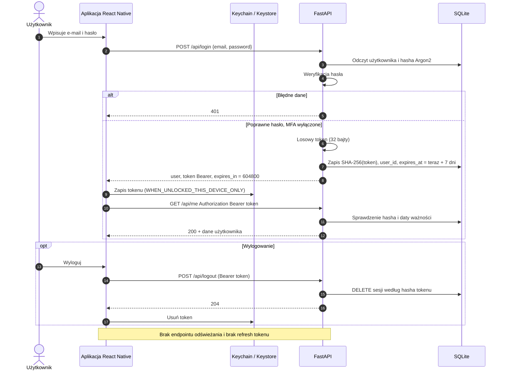
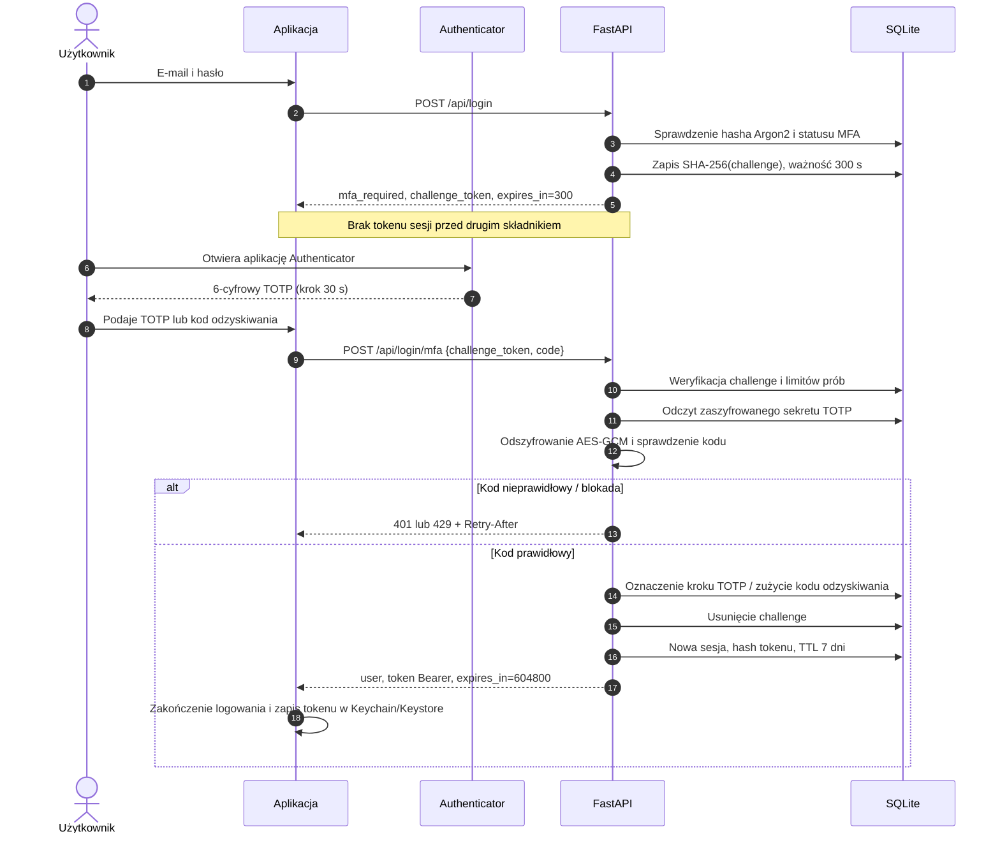
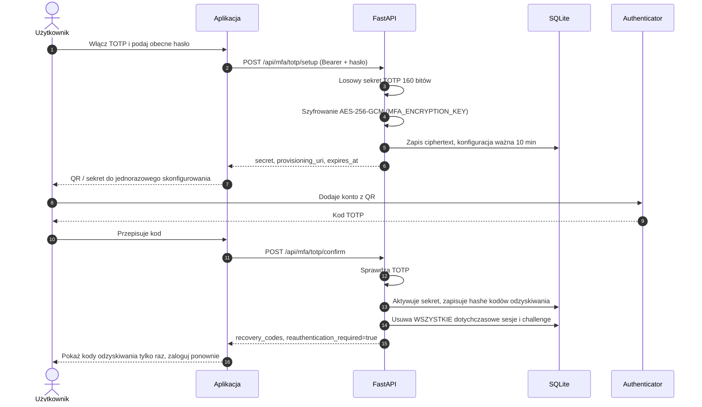
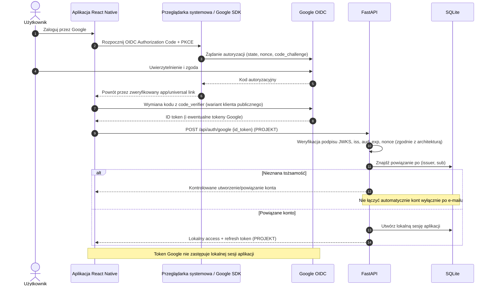
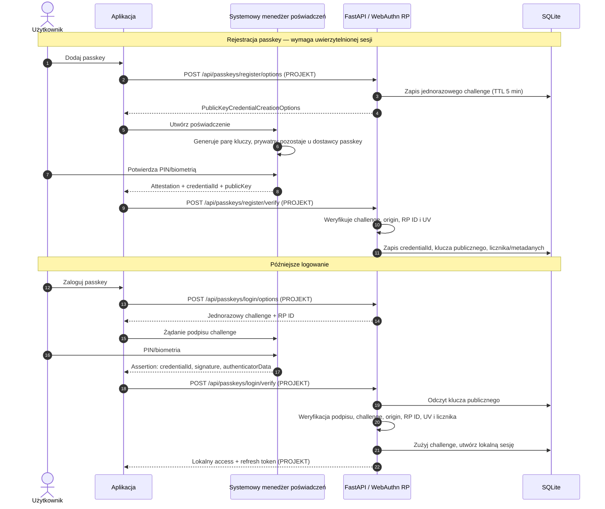

# Raport: logowanie i sesje — Pecunia non olet

### Elementy sesji

| Element | Gdzie powstaje | Gdzie leży | Ważny przez | Jak unieważnić | Problem | Decyzja i źródło |
|---|---|---|---|---|---|---|
| Hasło | Użytkownik podczas rejestracji | Backend: hash Argon2 w SQLite | Do zmiany hasła | Zmiana lub reset hasła | Ryzyko wycieku i ataków słownikowych | Argon2, limity prób logowania; OWASP Authentication Cheat Sheet |
| Token dostępu | Backend po poprawnym logowaniu, również po TOTP | React Native Keychain / Android Keystore; hash SHA-256 w SQLite | Obecnie 7 dni | Wylogowanie, zmiana hasła, wygaśnięcie, zmiana konfiguracji MFA | Skradziony token pozwala korzystać z konta nawet przez 7 dni | Docelowo access token ważny 15 minut; OWASP MASVS-AUTH |
| Token odświeżania | Obecnie nie istnieje; docelowo backend | Docelowo Keychain / Keystore; hash w bazie | Docelowo maks. 7 dni bezczynności, 30 dni absolutnie | Rotacja, wylogowanie, wygaśnięcie, wykrycie ponownego użycia | Obecnie brak bezpiecznego odświeżania sesji | Wprowadzić rotację i wykrywanie ponownego użycia; RFC 9700 |
| Sekret TOTP | Backend podczas konfiguracji MFA | Zaszyfrowany AES-256-GCM w SQLite; kopia w aplikacji Authenticator | Do wyłączenia lub ponownej konfiguracji MFA | Wyłączenie MFA i usunięcie sekretu | Przejęcie sekretu umożliwia generowanie kodów | Szyfrowanie kluczem MFA_ENCRYPTION_KEY poza repozytorium; RFC 6238 |
| Klucz prywatny passkey / biometria | Docelowo urządzenie lub menedżer poświadczeń | Klucz prywatny w bezpiecznym magazynie; publiczny na backendzie | Do usunięcia poświadczenia | Usunięcie passkey, cofnięcie dostępu | Utrata urządzenia lub przejęcie poświadczeń | WebAuthn/FIDO2, weryfikacja podpisu na backendzie; W3C WebAuthn |
| Token Google ID | Docelowo Google po uwierzytelnieniu | Tymczasowo aplikacja/backend podczas wymiany | Zgodnie z polem exp tokenu Google | Wygaśnięcie, odrzucenie tokenu; sesja lokalna unieważniana osobno | Ryzyko użycia tokenu dla innej aplikacji | Sprawdzać podpis, iss, aud, exp i sub; Google Identity |

## Mechanizmy

### 1.1.1 Logowanie e-mail i hasłem — [OBECNIE]

**Wyjaśnienie:** token jest nieprzezroczystym, losowym identyfikatorem sesji, **nie JWT**. Backend przechowuje jego hash i sprawdza go w bazie przy chronionych żądaniach. Po upływie 7 dni użytkownik musi zalogować się ponownie. Aplikacja przy starcie sprawdza `/api/me`; przy braku sieci może jednak przywrócić lokalny ekran na podstawie zapisanego tokenu i roli, bez potwierdzenia ważności sesji — serwer nadal chroni API. Źródła: `backend/app/sessions.py`, `backend/app/authorization.py`, `backend/app/main.py`, `src/controllers/useAppController.ts`.

### 1.1.2 Logowanie hasłem i TOTP — [OBECNIE]

**Parametry obecne:** challenge jednorazowy, ważny 5 minut; TOTP 6 cyfr, HMAC-SHA1, krok 30 s, akceptacja bieżącego i jednego poprzedniego kroku, bez ponownego wykorzystania zaakceptowanego kroku. Pięć błędnych kodów w 15 minut blokuje MFA na 15 minut; kody odzyskiwania są jednorazowe. Źródła: `backend/docs/TOTP_MFA.md`, `backend/app/routes/mfa.py`, `backend/app/totp.py`.

### 1.1.3 Włączenie TOTP i ochrona sekretu — [OBECNIE]

**Ważne rozróżnienie:** TOTP **nie wykorzystuje pary klucz publiczny/prywatny**. Wspólny sekret jest przechowywany przez Authenticator i backend. Na backendzie jest szyfrowany AES-256-GCM kluczem `MFA_ENCRYPTION_KEY` z pliku `.env`, poza repozytorium i SQLite; nonce jest unikalny, a AAD wiąże dane z użytkownikiem i przeznaczeniem. Utrata klucza uniemożliwia weryfikację zapisanych sekretów. Nie należy go utożsamiać z prywatnym kluczem TLS ani kluczem passkey. Źródło: `backend/docs/TOTP_MFA.md`.

### 1.1.4 Logowanie federacyjne Google — [PROJEKT]

**Decyzje:** zewnętrzna przeglądarka, PKCE S256, `state`, `nonce`, sprawdzenie ID tokenu i stabilnego `sub`, bez osadzania sekretu klienta w aplikacji. Backend musi zdefiniować bezpieczną procedurę łączenia kont. Wariant wymiany kodu po stronie backendu jest również dopuszczalny, lecz wymaga spójnego projektu redirect URI i PKCE. **Żaden z endpointów na diagramie oznaczonych „PROJEKT” nie został potwierdzony jako istniejący.** Źródła projektowe: karta F-08; RFC 8252, RFC 7636, OpenID Connect Core.

### 1.1.5 Passkeys (WebAuthn/FIDO2) — [PROJEKT]

**Klucz prywatny passkey:** nie jest wysyłany do backendu. Pozostaje w menedżerze poświadczeń / zabezpieczonym środowisku, może być synchronizowany między urządzeniami przez dostawcę passkeys. Backend zapisuje klucz publiczny i identyfikator poświadczenia. Biometria lub PIN służą lokalnemu odblokowaniu użycia klucza; aplikacja nie otrzymuje wzorca biometrycznego. Rejestracja powinna wymagać świeżego uwierzytelnienia. Źródła projektowe: karta F-09; W3C WebAuthn, FIDO Alliance.

### 1.1.6 Tabela elementów uwierzytelniania i sesji

| Element | Gdzie powstaje | Gdzie leży | Ważność | Unieważnienie | Problem / decyzja |
|---|---|---|---|---|---|
| Hasło [OBECNIE] | Użytkownik | Hash Argon2 w SQLite | Do zmiany | Zmiana hasła | Nigdy nie zapisywać jawnie; backend weryfikuje |
| Token sesji Bearer [OBECNIE] | FastAPI, `secrets.token_urlsafe(32)` | W aplikacji Keychain/Keystore; w SQLite SHA-256 | **7 dni od wydania** | `/api/logout`, zmiana hasła, zmiana stanu MFA, upływ czasu | Długi czas przejęcia; skrócić w modelu docelowym |
| Rola [OBECNIE] | Backend | SQLite; kopia UI w AsyncStorage | Do aktualizacji | Odczyt `/api/me` | AsyncStorage nie jest źródłem uprawnień; serwer sprawdza rolę |
| Challenge MFA [OBECNIE] | Backend | W aplikacji pamięć procesu; w SQLite hash | **5 min**, jednorazowy | Zużycie, wygaśnięcie, zmiana hasła/MFA | Nie daje dostępu do API bez kodu |
| Sekret TOTP [OBECNIE] | Backend | Authenticator + SQLite jako AES-GCM ciphertext | Do wyłączenia/rotacji | Wyłączenie MFA i usunięcie sekretu | Sekret symetryczny; zabezpieczyć klucz szyfrujący |
| Konfiguracja TOTP [OBECNIE] | Backend | SQLite zaszyfrowana | **10 min** | Potwierdzenie lub wygaśnięcie | Nie aktywować bez poprawnego kodu |
| Kod TOTP [OBECNIE] | Authenticator | Generowany z sekretu i czasu | **30 s na krok**, akceptowany również poprzedni krok | Odrzucenie ponownego użycia kroku | Limit 5 błędów / 15 min, blokada 15 min |
| Kod odzyskiwania [OBECNIE] | Backend | Użytkownik; hash w SQLite | Do użycia/odwołania | Jednorazowe zużycie, wyłączenie MFA | Pokazać tylko przy utworzeniu |
| Access token [PROJEKT] | Backend | Pamięć procesu aplikacji | **10 min** | Wygaśnięcie, revocation/sesja | Krótki token, nie trwały magazyn |
| Refresh token [PROJEKT] | Backend | Keychain/Keystore; hash w SQLite | **7 dni bezczynności, max 30 dni** | Rotacja, logout, reuse detection, wygaśnięcie | Nigdy nie przechowywać jawnie w SQLite |
| Google ID token [PROJEKT] | Google | Krótkotrwale w procesie | `exp` nadany przez Google | Wygaśnięcie; nie używać jako lokalnej sesji | Weryfikować podpis, issuer, audience, nonce |
| Klucz prywatny passkey [PROJEKT] | Authenticator/OS | Menedżer passkeys | Do usunięcia poświadczenia | Usunięcie lokalne lub cofnięcie rejestracji na serwerze | Nie eksportować do aplikacji ani backendu |
| Klucz publiczny passkey [PROJEKT] | Authenticator/OS | SQLite backendu | Do usunięcia poświadczenia | Usunięcie wpisu credentialId | Weryfikacja podpisów WebAuthn |

## 1.2 Scenariusze

| Scenariusz | Co powinno się stać | Co dzieje się obecnie / status |
|---|---|---|
| Wylogowanie | Natychmiastowa utrata dostępu na urządzeniu i serwerze | [OBECNIE] `/api/logout` usuwa hash sesji; aplikacja usuwa wpis Keychain |
| Zgubiony telefon | Zdalne odwołanie konkretnej sesji, ewentualnie wszystkich | [OBECNIE] Brak potwierdzonego interfejsu listy i zdalnego odwołania urządzeń |
| Zmiana hasła | Unieważnienie wszystkich sesji i challenge | [OBECNIE] Backend usuwa wszystkie sesje i challenge; wymaga ponownego logowania |
| Token wygasa podczas pracy | Próba odświeżenia lub powrót do logowania | [OBECNIE] 401 po 7 dniach; brak refresh endpointu | 
| Reinstalacja aplikacji | Brak niekontrolowanego przywrócenia sesji | [OBECNIE] Token ma `THIS_DEVICE_ONLY`; zachowanie Keychain na iOS po reinstalacji wymaga testu |
| Przechwycony token | Krótki okres użyteczności i możliwość revocation | [OBECNIE] Token ważny do 7 dni, chyba że usunięto rekord sesji |
| Google | Hasło widzi tylko Google, a backend potwierdza tożsamość | [PROJEKT] Brak wdrożenia | 
| Passkey / biometria | Prywatny klucz nie opuszcza dostawcy poświadczeń | [PROJEKT] `loginWithPasskey()` pokazuje komunikat o przyszłej implementacji |
| Włączenie MFA | Nowe sesje wymagają TOTP; stare wygasają | [OBECNIE] Potwierdzenie TOTP usuwa wszystkie sesje |
| Wyłączenie MFA | Hasło + kod; zakończenie wszystkich sesji | [OBECNIE] Backend wymaga obu i usuwa sesje | 
| Błędny kod TOTP | Ograniczenie zgadywania i brak wydania sesji | [OBECNIE] 5 prób / 15 min, blokada 15 min | 
| Brak klucza szyfrującego TOTP | Odmowa drugiego kroku, bez obejścia MFA | [OBECNIE] Błąd 503; brak przejścia na samo hasło | 
| Brak sieci przy starcie | Nie uznawać offline UI za potwierdzenie serwerowej sesji | [OBECNIE] UI może przejść do ekranu zalogowanego na podstawie cache |

**Uwaga o dowodach:** powyższe „obecnie” wynika z przeglądu kodu i dokumentacji, nie z uruchomienia testów w tym raporcie. Wykonanie testów i zrzuty wyników należy dopisać przed oddaniem, jeśli prowadzący wymaga empirycznego potwierdzenia.

## 1.3 Polityka sesji

### 1.3.1 Stan obecny a wartości docelowe

| Parametr | U nas teraz [OBECNIE] | Docelowo [PROJEKT] | Uzasadnienie |
|---|---|---|---|
| Token dostępu | Jeden Bearer, **7 dni** | Access token **10 min** | Mniejszy czas użycia po kradzieży |
| Token odświeżania | **Nie istnieje** | Rotowany, **7 dni idle**, **30 dni absolutnie** | Ciągłość pracy i ograniczenie trwałości sesji |
| Rotacja refresh tokenu | Brak | Przy każdym odświeżeniu rotacja tokenów | Ochrona przed replay |
| Odświeżanie | Brak | Gdy pozostało < 2 min TTL lub po 401 `token_expired`, jeden retry | Bez niepotrzebnych żądań |
| Limit nieudanych haseł | Brak potwierdzonego limitu; CAPTCHA/Turnstile przy rejestracji | **5 prób / 15 min** na konto + limity IP, opóźnienia, 15-min blokada | Obrona przed brute force, bez łatwego DoS |
| Limit MFA | **5 błędnych / 15 min → blokada 15 min** | Zachować | Istniejąca kontrola |
| TOTP | **6 cyfr, 30 s, poprzedni krok** | Zachować; monitoring dryfu zegara | RFC 6238 |
| Challenge MFA | **5 min** | Zachować | Krótkotrwały, jednorazowy |
| Konfiguracja TOTP | **10 min** | Zachować | Ograniczenie czasu niepotwierdzonego sekretu |
| Liczba sesji | Brak potwierdzonego limitu | Maks. **5 aktywnych urządzeń**, widok i odwołanie sesji | Kontrola nad urządzeniami |
| Po zmianie hasła | Wszystkie sesje usuwane | Zachować + powiadomienie | Ograniczenie przejęcia konta |
| Po włączeniu/wyłączeniu MFA | Wszystkie sesje usuwane | Zachować | Zmiana poziomu uwierzytelnienia |
| Logout | DELETE sesji po hash tokenu | Unieważnienie całej rodziny refresh + powiązanego access | Natychmiastowe zakończenie sesji |
| Reinstalacja / backup | Token w Keychain/Keystore | Token refresh nieprzenoszalny na inne urządzenie; polityka czyszczenia przy reinstalacji | Ograniczenie odzyskania sesji z kopii |

